<p align="center">
  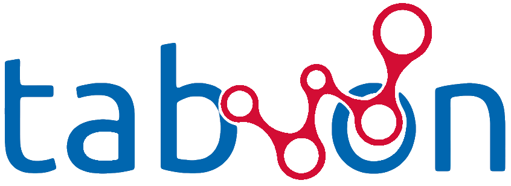
</p>

<h3 align="center">Tabulador Livre de dados do SUS</h3>

<p align="center">
  Versão 1.00.0 · Windows · Código aberto (GPL-3.0) · Funciona 100% no seu computador
</p>

---

## Sumário

1. [Sobre o projeto](#1-sobre-o-projeto)

   * [Fase de testes e versão oficial](#fase-de-testes-e-versão-oficial)
2. [Autor, repositório e licença](#2-autor-repositório-e-licença)
3. [Recursos e diferenciais](#3-recursos-e-diferenciais)
4. [Como baixar o projeto](#4-como-baixar-o-projeto)
5. [Estrutura do projeto](#5-estrutura-do-projeto)
6. [Arquivos importantes para ler](#6-arquivos-importantes-para-ler)
7. [Requisitos](#7-requisitos)
8. [Rodar sem compilar (direto pelo Python)](#8-rodar-sem-compilar-direto-pelo-python)
9. [Compilar o TabWonDBC](#9-compilar-o-tabwondbc)
10. [Compilar o TabWon](#10-compilar-o-tabwon)
11. [O que colocar na pasta do TabWon para funcionar](#11-o-que-colocar-na-pasta-do-tabwon-para-funcionar)
12. [Telas](#12-telas)
13. [Como contribuir](#13-como-contribuir)
14. [Agradecimentos](#14-agradecimentos)

---

## 1. Sobre o projeto

O **TabWon** é um programa de tabulação de dados que trabalha com os mesmos arquivos do
**TabWin**: **DEF**, **CNV**, **DBF** e **DBC**. Com ele é possível montar tabelas cruzadas,
aplicar filtros, criar colunas calculadas, gerar gráficos e estatísticas e exportar os
resultados, a partir das bases do SUS como SIA, SIH, SIM, SINASC e outras.

**Inspiração e vínculo:** O TabWon é **inspirado no TabWin** e **não tem nenhum vínculo com o
DATASUS** nem com o Ministério da Saúde. É um projeto independente, feito por quem tabula dados
do SUS no dia a dia.

**Por que os mesmos formatos?** A ideia original é **somar**: oferecer novos recursos ao SUS e
às análises com tabulação de dados sem obrigar a refazer seu trabalho. Por isso o TabWon
lê os mesmos DEFs, CNVs, DBFs e DBCs que já existem nas secretarias, em diversos estabelecimentos de saúde e nas
universidades.

**Por que código aberto:** O TabWin tem recursos que o TabWon ainda não incorporou, como a
integração com o R. Assim como o TabWon oferece facilidades que o TabWin não possui, como salvar log ou tabular apenas colando um log copiado do TabWin. O TabWon é aberto justamente para que a comunidade possa estudá-lo,
corrigi-lo, adaptá-lo à sua realidade e contribuir com novos recursos, **fortalecendo ainda mais
o SUS**.

**Agradecimento:** Ao Ministério da Saúde e ao DATASUS, que criaram o TabWin, definiram os
formatos DEF, CNV e disponibilizam as bases públicas. Sem esse legado, o TabWon não
existiria.

### Fase de testes e versão oficial

O TabWon está na **versão 1.00.0, em fase de testes**. Antes da versão oficial, o programa passa
por **três etapas de testes**, cada uma com um número mínimo de pessoas:

|Etapa|Testadores (mínimo)|Objetivo|
|-|-|-|
|1ª|3|Encontrar erros e verificar as funções principais|
|2ª|5|Ampliar os cenários de uso, receber sugestões e corrigir o que for encontrado|
|3ª|7|Auditoria final dos resultados, do desempenho e da documentação|

Em todas as etapas, os testadores verificam erros, fazem sugestões e auditam os resultados.

**Quando a fase de testes terminar**, o programa oficial compilado será disponibilizado neste
mesmo repositório, na área **Releases**, para download por quem não programa, com o aviso
correspondente aqui no README.

> ⚠️ **Enquanto isso, não recomendamos baixar versões derivadas deste projeto que possam estar
> disponíveis em outros locais.** As únicas fontes oficiais do TabWon são
> <https://github.com/thiagusr/TabWon>
> <https://tabwon.org>.

---

## 2. Autor, repositório e licença

|||
|-|-|
|**Autor**|Thiago Rodrigues (thiagusr) — Porto Alegre/RS|
|**Origem**|Demanda real da Equipe de Processamento SIA/SMS de Porto Alegre/RS|
|**Repositório**|[https://github.com/thiagusr/TabWon](https://github.com/thiagusr/TabWon)|
|**Site oficial**|[https://tabwon.org](https://tabwon.org)|
|**Licença**|[GNU GPL v3](LICENSE) (GPL-3.0-only)|

O TabWon é **software livre**: você pode usar, estudar, copiar, modificar e redistribuir, desde
que mantenha a mesma licença e disponibilize o código-fonte.

**Manter a autoria é obrigatório.** O projeto usa o termo adicional da seção 7(b) da GPL-3.0:
qualquer cópia, versão modificada ou obra derivada deve manter os arquivos `LICENSE` e
`AVISO.md` e a menção ao programa original **TabWon** e ao autor **Thiago Rodrigues**, inclusive
na tela **Sobre**. Os detalhes estão em [`AVISO.md`](AVISO.md).

---

## 3. Recursos e diferenciais

* **Mesmos arquivos do TabWin:** abre os DEFs, CNVs, DBFs e DBCs que você já usa e cola logs do
TabWin para remontar a tabulação.
* **Rápido:** na primeira leitura, cada DBC é convertido para Parquet pelo **TabWonDBC**, e as
próximas tabulações ficam muito mais rápidas.
* **Superlog:** grava a consulta com **todos os ajustes** feitos no resultado (colunas, operações,
formatos, gráficos) e refaz tudo com um clique.
* **Últimas pesquisas:** guarda sozinho as 10 últimas tabulações e as reabre direto no resultado.
* **Consultas salvas** com identificador por equipe, cópia de segurança automática e
**execução em lote** (um XLSX por consulta).
* **Operações e funções:** soma, subtração, multiplicação, divisão, porcentagem, datas,
acumulados, ranking, variação, indicadores, funções de texto e outras.
* **Estatística:** médias, mediana, quartis, desvio, intervalos de confiança, correlação,
regressão, testes t e qui-quadrado e análise bayesiana.
* **20 tipos de gráfico:** barras, pizza, rosca, pareto, pirâmide etária, mapa de calor,
boxplot, velocímetro, treemap e outros.
* **Consultor SQL** sobre os DBCs, passo a passo ou escrevendo o SQL.
* **Editores de DEF e CNV** com análise e correção guiada; **conversor DBF ⟺ DBC** com teste de
integridade.
* **Exportação** para XLSX, CSV e área de transferência (formatado, texto ou imagem).
* **Interface** em português, inglês e espanhol; modos claro, escuro e automático; 10 paletas e
20 modelos de ícones; personalização por usuário.
* **Privacidade:** funciona 100% no computador, sem enviar dados para fora.

---

## 4. Como baixar o projeto

**Clicando:** na página do repositório, clique no botão verde **Code** e depois em
**Download ZIP**. Descompacte o arquivo numa pasta de sua escolha.

**Pelo prompt** (precisa do [Git](https://git-scm.com) instalado):

```bat
git clone https://github.com/thiagusr/TabWon.git
cd TabWon
```

Para atualizar uma cópia já baixada com `git clone`:

```bat
git pull
```

### O que vem no repositório e o que não vem

Para manter o download leve, o repositório traz **apenas o código-fonte, as configurações e a
documentação**. Ficam de fora (veja o arquivo [`.gitignore`](.gitignore)):

|Fora do repositório|Como obter|
|-|-|
|Bibliotecas do Python (pandas, DuckDB, pyarrow, Matplotlib etc.)|São baixadas automaticamente pelo `compilar.bat` ou pelo comando `pip` da [seção 8](#8-rodar-sem-compilar-direto-pelo-python).|
|Pasta `TabWon_dependencias` e o `TabWon.exe`|São gerados pela compilação ([seção 10](#10-compilar-o-tabwon)).|
|`TabWonDBC.exe`|É gerado a partir do código da pasta `TabWonDBC` ([seção 9](#9-compilar-o-tabwondbc)).|
|Bases de dados (DBC, DBF, Parquet) e consultas pessoais|Nunca são publicadas. Use as suas.|

**Resumo:** quem baixa o repositório recebe tudo o que precisa para rodar ou compilar; as
bibliotecas vêm da internet, na primeira execução do `pip` ou do `compilar.bat`.

---

## 5. Estrutura do projeto

```
TabWon/
├─ TabWon.py              programa principal (código-fonte)
├─ TabWon.spec            roteiro de compilação do PyInstaller
├─ compilar.bat           compila o TabWon com um duplo clique
├─ dicionario_funcoes.md  referência das funções do código-fonte
├─ README.md              este arquivo
├─ AVISO.md               autoria, licença e termos adicionais
├─ LICENSE                texto da GNU GPL v3
├─ TabWon_configs/        configurações, idiomas, ajuda, paletas, ícones e logotipos
├─ TabWon_dependencias/   bibliotecas usadas pelo executável (gerada na compilação)
├─ TabWonDBC/             código-fonte do conversor TabWonDBC (C#/.NET 8)
├─ Imagens/               arquivos-fonte das imagens (GIMP) e modelos de ícones
├─ Prints/                telas do programa usadas neste README
└─ .gitignore             o que fica fora do repositório
```

### O que esperar de cada diretório

|Diretório|O que contém|
|-|-|
|**`TabWon_configs/`**|Tudo o que o TabWon lê enquanto roda e que pode ser editado sem mexer no código: configuração geral (`TabWon_configs.ini`), arquivos de idioma (`.lng`), textos de ajuda e de "Sobre", paletas de cores (`.cor`), modelos de ícones (`icones/`), logotipos e ícone do programa. Também é onde fica o **`TabWonDBC.exe`** compilado. Durante o uso, o TabWon cria aqui as consultas salvas, as preferências de cada usuário (`.usuarios/`), o cache dos DBCs (`.cache_dbc/`) e as cópias de segurança (`.backups_consultas/`).|
|**`TabWon_dependencias/`**|Bibliotecas (Python, pandas, matplotlib, DuckDB, pyarrow etc.) que o `TabWon.exe` usa. É **gerada automaticamente** pelo `compilar.bat`, **não vem no repositório** e não deve ser editada. Pode ser apagada e recriada a qualquer momento.|
|**`TabWonDBC/`**|Código-fonte em C# do **TabWonDBC**, o conversor de DBC para Parquet e de DBF ⟺ DBC usado pelo TabWon. Tem README, licença e aviso de autoria próprios.|
|**`Imagens/`**|Arquivos-fonte editáveis (`.xcf`, do GIMP) do logotipo, do ícone, das imagens da tela "Sobre", e os modelos para criar novos conjuntos de ícones, com o mapa de cada ícone.|
|**`Prints/`**|Capturas das principais telas, nos modos claro e escuro, usadas neste README.|

---

## 6. Arquivos importantes para ler

|Arquivo|Para quê|
|-|-|
|[`AVISO.md`](AVISO.md)|Autoria, licença, termos adicionais e componentes de terceiros. **Leia antes de redistribuir ou modificar.**|
|[`LICENSE`](LICENSE)|Texto completo da GNU GPL v3.|
|[`dicionario_funcoes.md`](dicionario_funcoes.md)|Todas as funções do `TabWon.py`, com linha e descrição. Ponto de partida para quem vai mexer no código.|
|[`TabWon_configs/TabWon_ajuda.txt`](TabWon_configs/TabWon_ajuda.txt)|Guia completo de uso (também em inglês e espanhol: `_ENUS` e `_ESES`). É o mesmo texto da Ajuda dentro do programa.|
|[`TabWon_configs/TabWon_configs.ini`](TabWon_configs/TabWon_configs.ini)|Configurações que valem para todos os usuários: itens do menu, identificadores das consultas, paletas, idiomas e ícones padrão. Também pode ser editado em *Shift + clique na ⚙*.|
|[`TabWon_configs/icones/LEIA-ME.txt`](TabWon_configs/icones/LEIA-ME.txt)|Como funcionam os modelos de ícones e como criar um novo.|
|[`Imagens/README.md`](Imagens/README.md)|Como editar as imagens e criar ícones no GIMP.|
|[`TabWonDBC/README.md`](TabWonDBC/README.md)|Como compilar e usar o TabWonDBC.|
|[`TabWonDBC/AVISO.md`](TabWonDBC/AVISO.md)|Autoria e licença do TabWonDBC.|

**Para criar uma tradução:** copie um dos arquivos `TabWon_configs/TabWon_lng_XXXX.lng`, traduza os
textos e libere o idioma em *Configurações avançadas → Idioma*. O cabeçalho do arquivo explica o
formato.

---

## 7. Requisitos

### Para usar o TabWon já compilado

||Mínimo|Recomendado|
|-|-|-|
|Sistema|Windows 10 64 bits|Windows 10 ou 11 64 bits|
|Processador|2 núcleos|4 núcleos ou mais (a conversão de DBCs usa todos)|
|Memória|4 GB|8 GB ou mais para bases grandes|
|Disco|400 MB para o programa|Mais o espaço do cache Parquet, parecido com o tamanho dos DBCs|
|Tela|1366 × 768|1920 × 1080|

**Não precisa** de Python instalado nem de permissão de administrador. O programa roda de
qualquer pasta, inclusive da rede ou de um pen drive.

### Para rodar pelo código-fonte ou compilar

* **Python 3.11 ou mais novo**, de 64 bits, baixado em [https://www.python.org/downloads/](https://www.python.org/downloads/).
Na instalação, marque **"Add python.exe to PATH"** e mantenha a opção **"tcl/tk and IDLE"**.
Testado no Python 3.12 e no 3.15.
* **Internet** na primeira vez, para baixar as bibliotecas.
* **Para compilar o TabWonDBC:** o **.NET 8 SDK** (gratuito), em
[https://dotnet.microsoft.com/download/dotnet/8.0](https://dotnet.microsoft.com/download/dotnet/8.0). Baixe a opção **SDK**, não a Runtime.
* Nada disso exige administrador se você instalar "só para o usuário atual".

---

## 8. Rodar sem compilar (direto pelo Python)

1. Instale o Python (veja os [requisitos](#para-rodar-pelo-código-fonte-ou-compilar)).
2. Abra o **Prompt de Comando** na pasta do TabWon. No Explorador de Arquivos, digite `cmd` na
barra de endereço e tecle Enter.
3. Instale as bibliotecas (uma vez só):

```bat
   python -m pip install pandas duckdb pyarrow openpyxl matplotlib pillow pywin32
   ```

4. Ponha o **`TabWonDBC.exe`** dentro de `TabWon_configs` (veja a [seção 9](#9-compilar-o-tabwondbc)).
5. Rode o programa:

```bat
   python TabWon.py
   ```

   Para abrir sem a janela preta do prompt, use `pythonw TabWon.py` ou crie um atalho para ele.

---

## 9. Compilar o TabWonDBC

O TabWon depende do **TabWonDBC.exe** para ler os DBCs (conversão para Parquet) e para converter
DBF ⟺ DBC. Ele precisa ser compilado uma vez e colocado na pasta **`TabWon_configs`**.

1. Instale o **.NET 8 SDK** e confira no prompt: `dotnet --version` (deve mostrar `8.0.xxx`).
2. Abra o prompt na pasta `TabWonDBC` e rode:

```bat
   dotnet publish -c Release
   ```

3. O executável fica em:

```
   TabWonDBC\bin\Release\net8.0\win-x64\publish\TabWonDBC.exe
   ```

4. **Copie o `TabWonDBC.exe` para dentro de `TabWon_configs`.**

O executável é autocontido: não precisa de .NET instalado no computador de quem só vai usar.
Detalhes, opções e solução de problemas estão em [`TabWonDBC/README.md`](TabWonDBC/README.md).

---

## 10. Compilar o TabWon

A compilação gera o **`TabWon.exe`** e a pasta **`TabWon_dependencias`**. O código e o ícone do
programa vão para dentro do executável, e todo o resto (configurações, DEFs, CNVs, DBCs) fica do
lado de fora, editável.

1. Instale o Python (veja os [requisitos](#para-rodar-pelo-código-fonte-ou-compilar)).
2. Confira se estes arquivos estão na mesma pasta:

   * `TabWon.py`
   * `TabWon.spec`
   * `compilar.bat`
   * `TabWon_configs\TabWon_icos.ico`
3. Dê **duplo clique em `compilar.bat`**. Ele:

   * cria um ambiente Python limpo só para a compilação (`.venv_build`), sem administrador;
   * baixa as bibliotecas e o PyInstaller;
   * gera o programa.
4. O resultado aparece em **`dist\TabWon`**:

   * `TabWon.exe`
   * `TabWon_dependencias\`

A primeira compilação leva alguns minutos; as seguintes são mais rápidas. Se aparecer um erro
dizendo que falta um módulo, acrescente o nome dele à lista `ocultos` no início do
`TabWon.spec` e compile de novo.

> **Por que uma pasta de dependências e não um único .exe?** Um executável de arquivo único
> precisa descompactar cerca de 150 MB a cada abertura, o que deixa o programa lento para abrir
> e costuma acionar o antivírus. Com a pasta, ele abre direto.

---

## 11. O que colocar na pasta do TabWon para funcionar

Depois de compilar, monte a pasta que será usada (ou distribuída) assim:

```
TabWon/
├─ TabWon.exe               ← gerado na compilação
├─ TabWon_dependencias/     ← gerado na compilação (não mexer)
├─ TabWon_configs/          ← copie a pasta do projeto
│   ├─ TabWonDBC.exe        ← compilado na seção 9
│   └─ Outros arquivos      ← Demais arquivos originais deste diretório
├─ SEU_ARQUIVO.def          ← seus DEFs
├─ SEU_ARQUIVO.cnv          ← seus CNVs (ou nas pastas indicadas nos DEFs)
└─ ...
```

* **Obrigatórios:** `TabWon.exe`, `TabWon_dependencias/`, `TabWon_configs/` (com o
`TabWonDBC.exe` dentro e demais arquivos desta pasta) e pelo menos um **DEF e devidas CNV**.
* **DBCs:** ficam onde a linha `A` de cada DEF indicar, inclusive em pastas da rede.
* **Não copie** as pastas `.usuarios`, `.cache_dbc` e `.backups_consultas` do seu computador:
elas são pessoais e o TabWon as recria.
* Inclua `LICENSE` e `AVISO.md` ao distribuir (exigência da licença).
* Para **atualizar** o programa, troque apenas o `TabWon.exe` e a `TabWon_dependencias`. As
configurações, consultas salvas e preferências são preservadas.

---

## 12. Telas

| | |
|---|---|
| **Tela inicial**<br>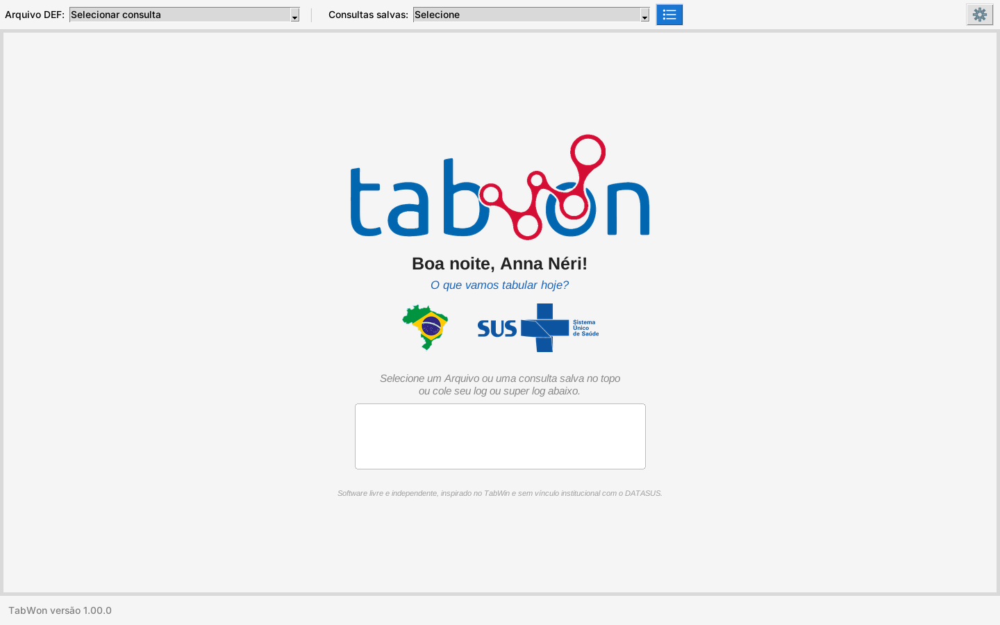 | **Seleção da tabulação**<br>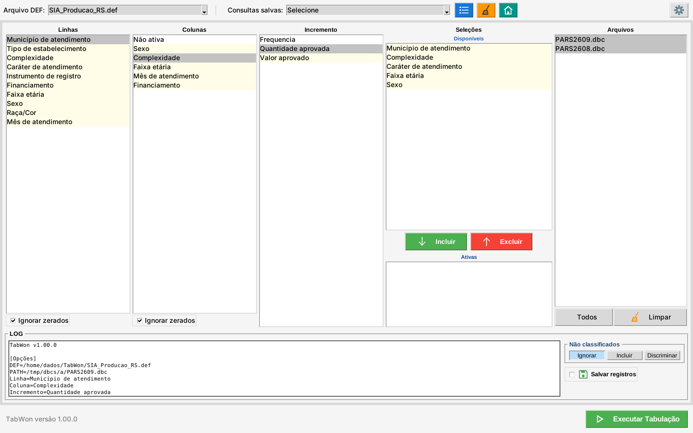 |
| **Criar gráfico**<br>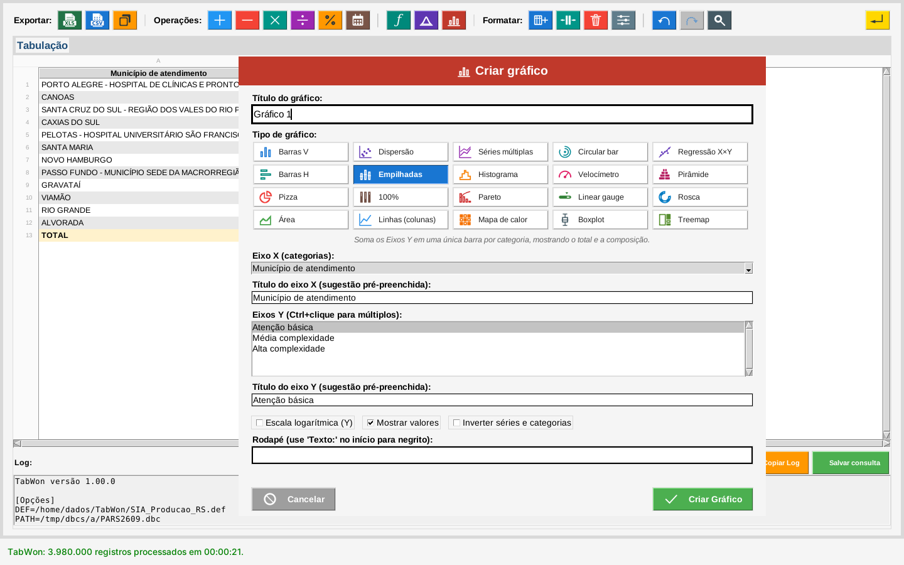 | **Funções**<br>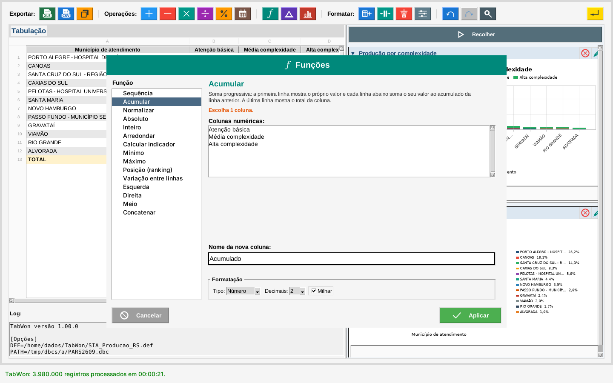 |
| **Estatística**<br>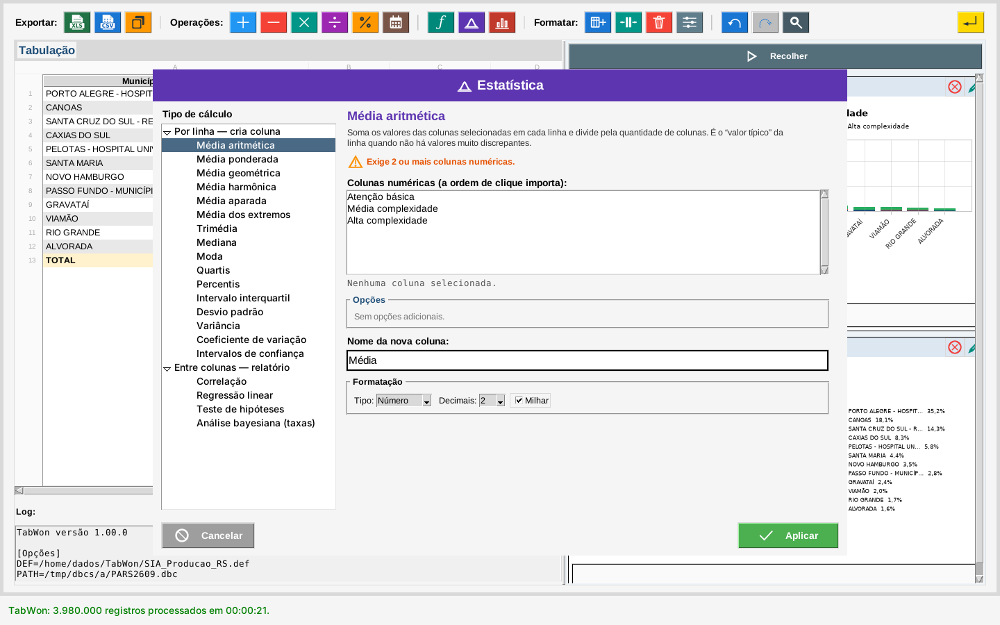 | **Conversor DBF ⟺ DBC**<br>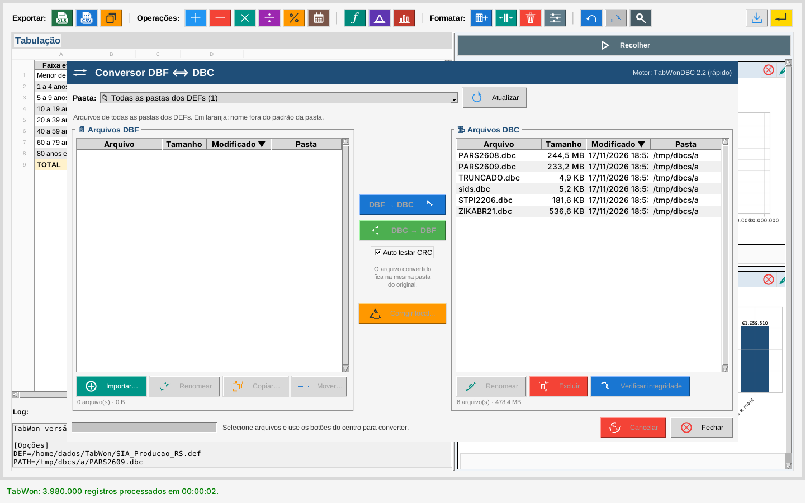 |
| **Consultor SQL**<br>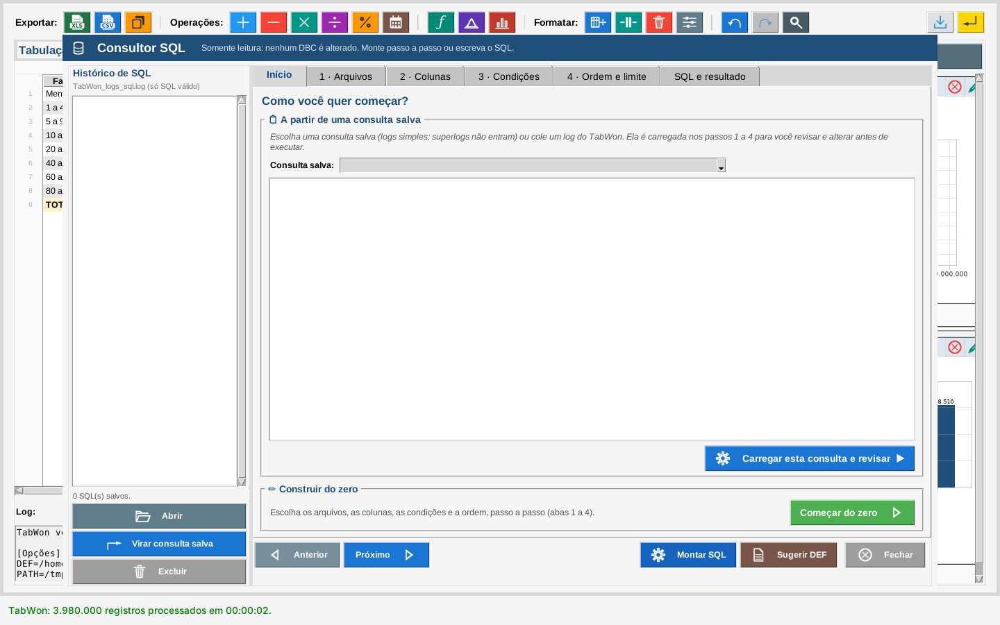 | **Editor de DEF**<br>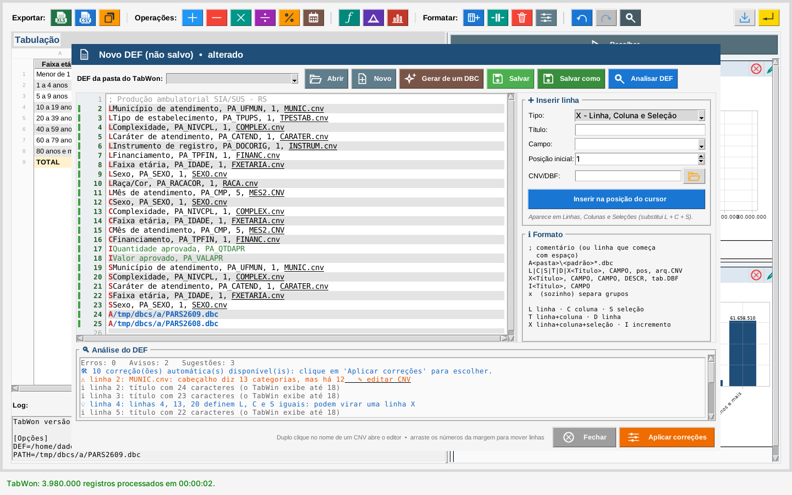 |
| **Configurações**<br>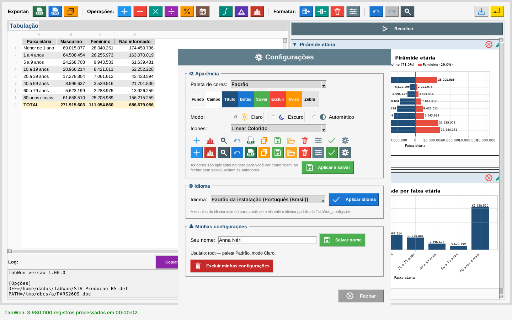 | **Tela inicial no modo escuro**<br>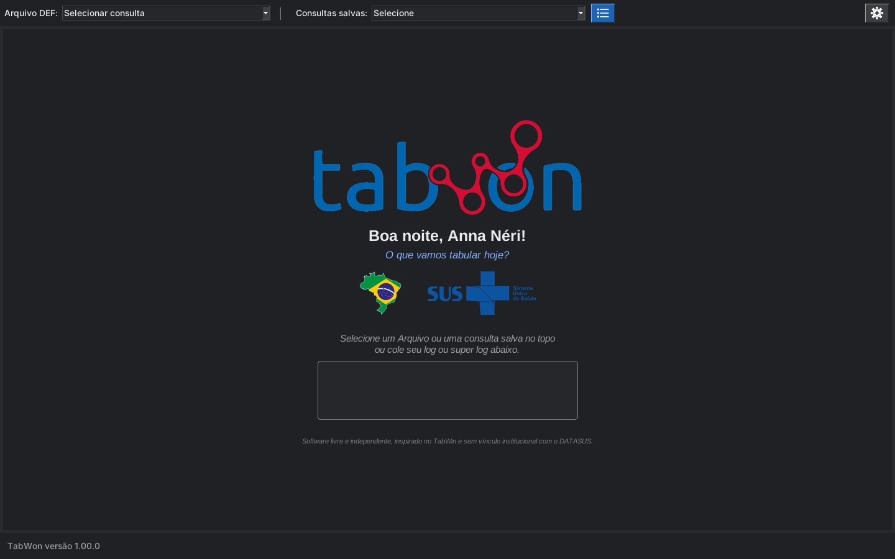 |
| **Consultas salvas (modo escuro)**<br>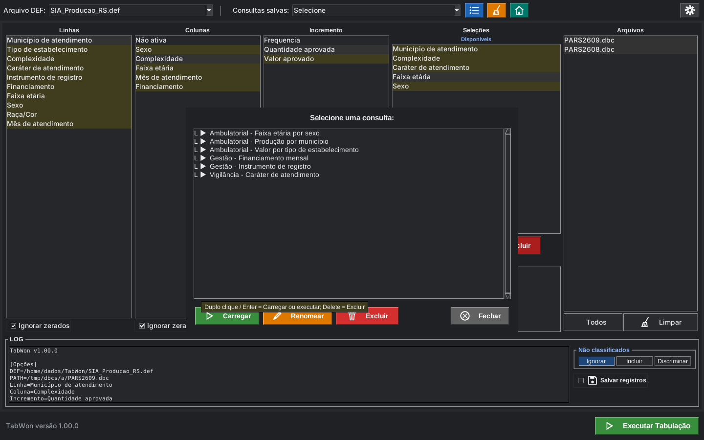 | **Detalhes da tabulação (modo escuro)**<br>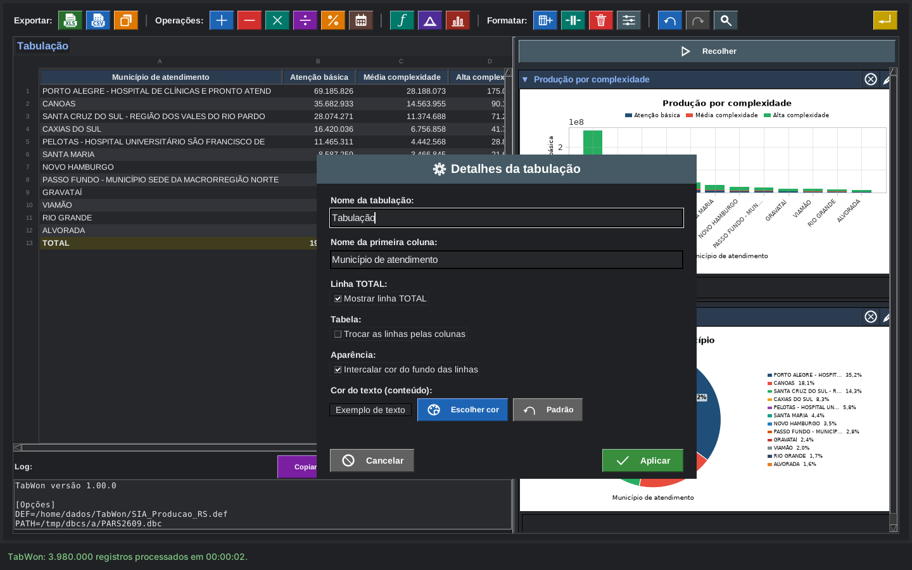 |
| **Últimas pesquisas (modo escuro)**<br>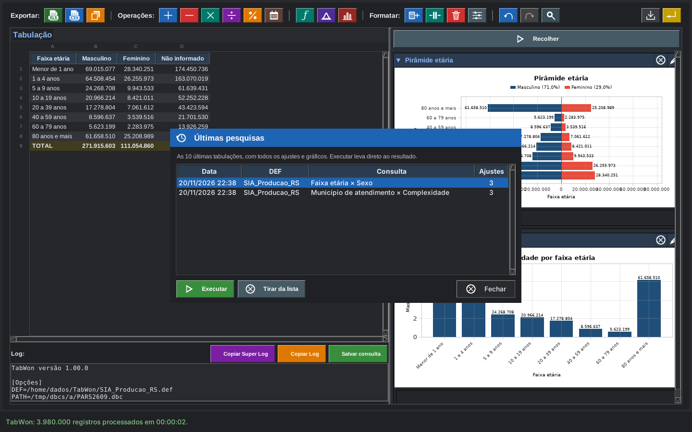 | **Editor de CNV (modo escuro)**<br>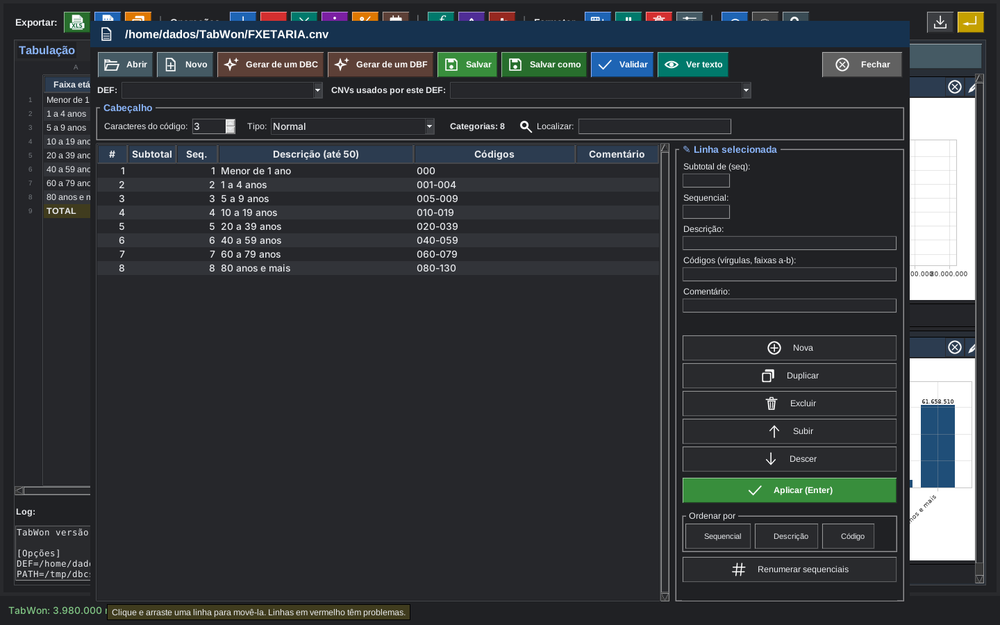 |

**Os 20 tipos de gráfico:**

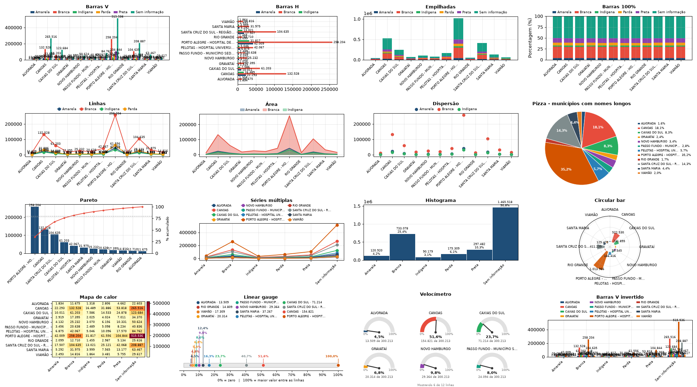

Os dados das telas são de teste e não representam informações reais.

---

## 13. Como contribuir

* **Relatar problemas:** abra uma *issue* no repositório. No programa, o item
*⚙ → Relatório de problema* gera um ZIP com as informações técnicas, sem os dados.
* **Sugerir recursos:** abra uma *issue* explicando o uso e, se possível, um exemplo de DEF.
* **Enviar código:** faça um *fork*, crie um *branch*, faça as alterações e abra um
*pull request*. Consulte o [`dicionario_funcoes.md`](dicionario_funcoes.md) para se localizar
no código.
* **Traduções, paletas e ícones** também são contribuições bem-vindas (veja a
[seção 6](#6-arquivos-importantes-para-ler)).

Ao contribuir, você concorda que sua contribuição seja distribuída sob a GPL-3.0, mantendo a
autoria original do projeto conforme o [`AVISO.md`](AVISO.md).

---

## 14. Agradecimentos

* Ao **Ministério da Saúde** e ao **DATASUS**, pelo TabWin, pelos formatos DEF e CNV e pelas
bases públicas do SUS.
* Às comunidades de software livre, profissionais de saúde e colaboradores em geral para este
projeto.

<p align="center"><b>TabWon</b> — feito por quem tabula o SUS, para quem faz gestão no SUS.</p>